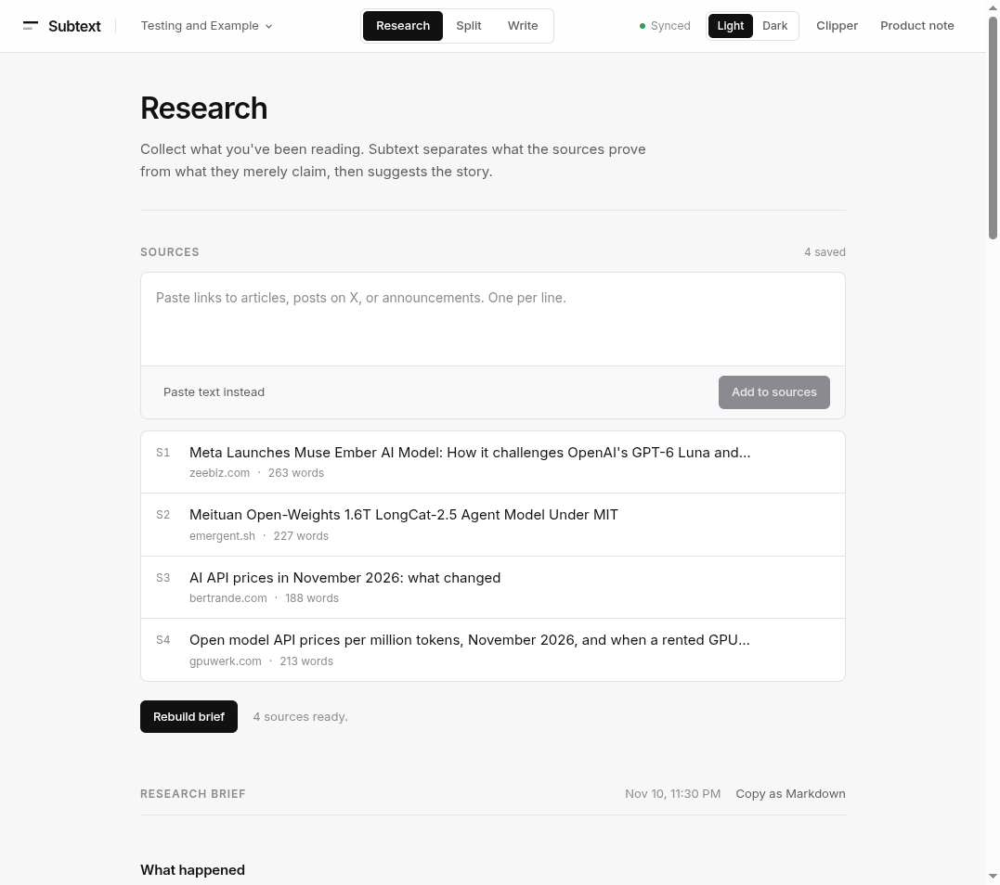
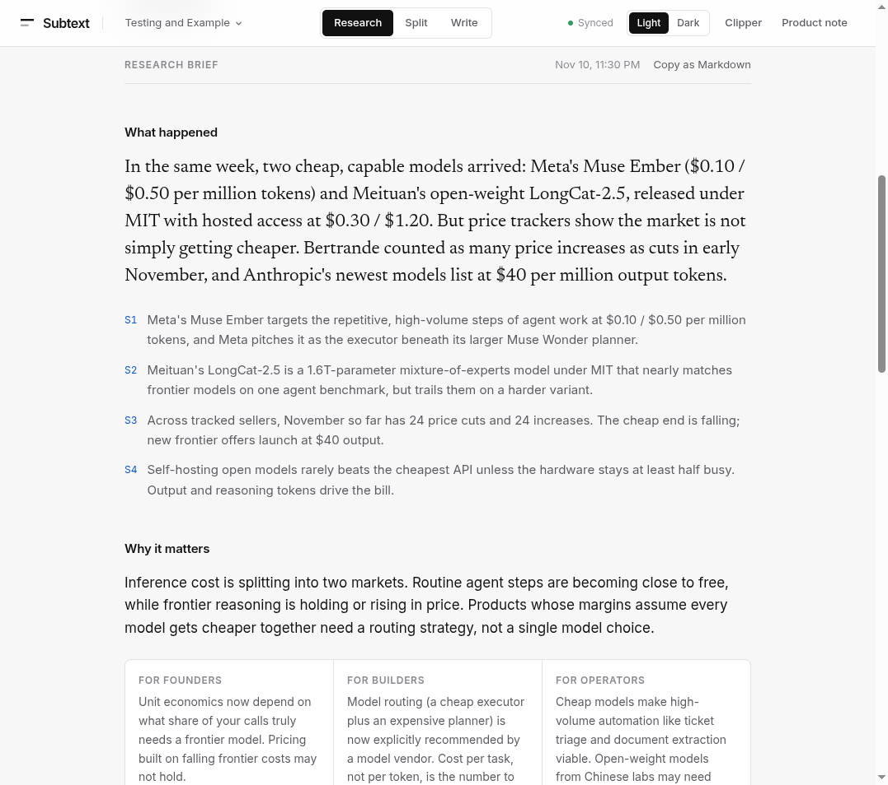
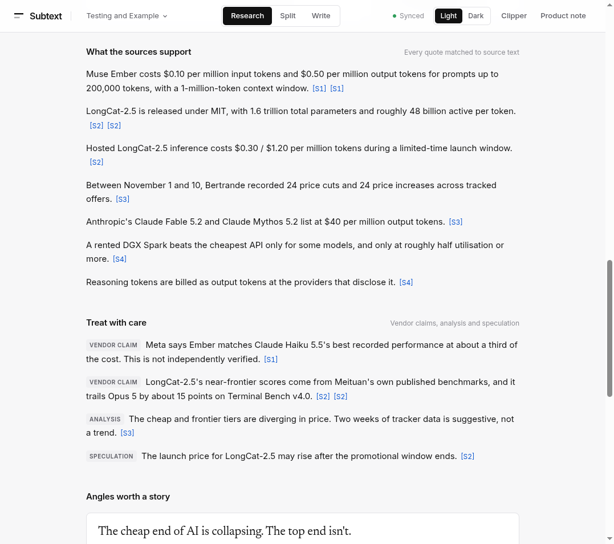
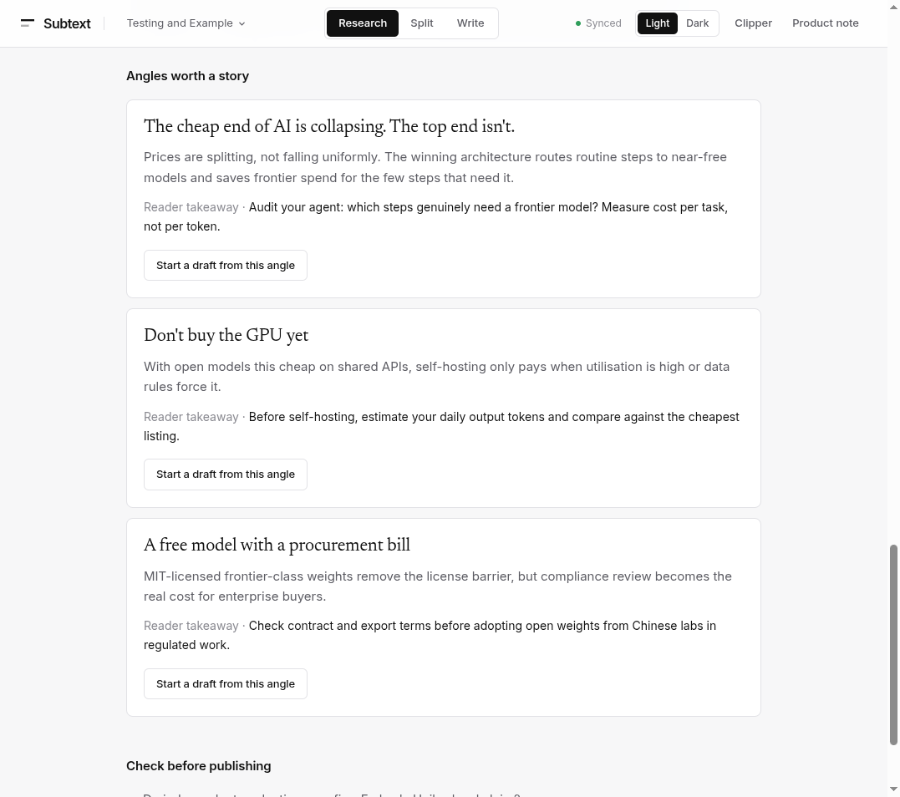
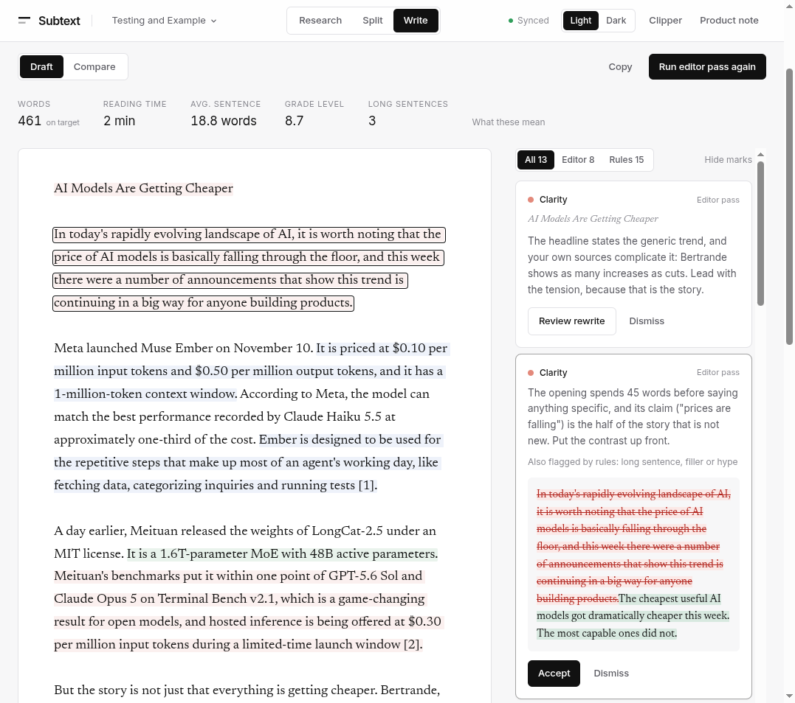
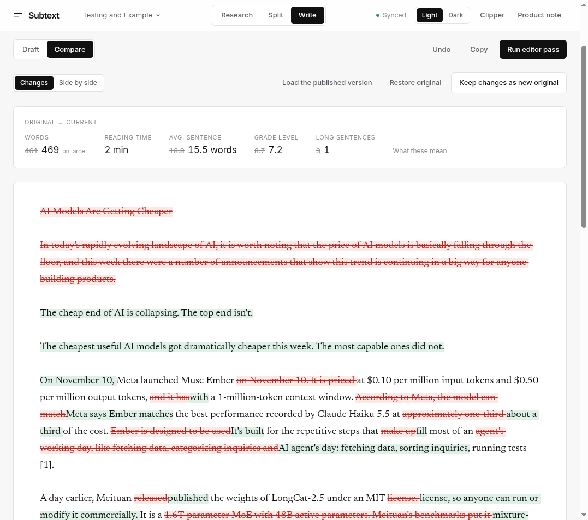

# Subtext Newsletter

A writing desk for people who write AI newsletters. You collect what you read, Subtext turns it into a research brief with checked facts, and then helps you edit your draft.

**Live:** [subtext-newsletter.vercel.app](https://subtext-newsletter.vercel.app)

---

## What it is

Writing a good newsletter is not about summarising. Summaries are easy now. The hard part is finding the real story in ten different links and making sure every claim you write is actually backed by a source.

Subtext is built for one editor at a small AI newsletter who reads a lot and publishes one or two pieces a week for founders, builders, and operators.

It does three things:

1. **Collect** — paste links, posts on X, or plain text, or save pages while you browse.
2. **Research** — get a brief that shows what happened, why it matters, and which facts the sources really support.
3. **Write** — draft next to the brief and get clear editing notes that you can accept or ignore. Your original is never lost.

The site opens on an empty space. A finished example called **Testing and Example** is one click away, so you can see every feature without adding anything.

---

## Features

### Collect sources

Paste links to articles, posts on X, or announcements, one per line. Each page is read on the server and cleaned into plain text. If a page can't be read (login wall, bot check, PDF, timeout), it says why and lets you paste the text yourself.



### Research brief

One click builds a brief from all your sources: what happened, a one-line takeaway from each source, and why it matters for founders, builders, and operators.



### Facts you can trust

Every fact in the brief comes with a short quote from a source. The server checks that the quote really appears in that source. If it doesn't, the fact is marked as unsupported instead of being shown as true. Vendor claims, analysis, and guesses are kept in a separate list so they don't get mixed up with facts.



### Story angles

The brief suggests a few angles for the piece, each with a headline and a takeaway for the reader. Pick one and Subtext starts a rough draft from it.



### Editor pass

Two kinds of notes appear next to your draft:

- **Rule checks** run as you type: long sentences, passive voice, filler words, dense paragraphs.
- **Editor notes** come from AI: unclear openings, unexplained jargon, repetition, and claims that don't match the sources.

Each note explains the problem and can suggest a rewrite. Nothing changes until you click **Accept**. Live numbers at the top show word count, reading time, average sentence length, grade level, and long sentences.



### Before and after

**Compare** shows every word that changed between your original and the current draft, along with how the numbers moved. Undo and restore are always there.



### Spaces

Each piece you work on lives in its own space. New spaces show at the top, the example stays at the bottom. Spaces are saved in the browser and synced to Supabase when it is set up.

### Save from anywhere

A bookmarklet and a small Chrome extension let you save a page while you read it. The saved page lands in whichever space is open. Because it uses the text your browser already sees, it also works for paywalled and logged-in pages.

### Light and dark mode

Switch with **Light / Dark** in the header. The first visit follows your system setting, and your choice is remembered.

### Safe links

Subtext only reads public web pages. Every link is checked before it is opened:

- Local and private network addresses are refused.
- Redirects are checked again at every step.
- Adult, gambling, and piracy sites are refused, using a list of known domains and the content labels those sites put on their own pages.
- The same check applies to the link box, the bookmarklet, the extension, and the save API.
- Each page has a time limit and a size limit.

---

## How it was built

| Part | What I used |
|---|---|
| App | Next.js 16 (App Router), React 19, TypeScript |
| Styling | Tailwind CSS 4 |
| AI | Google Gemini 2.5 Flash, with JSON output |
| Reading pages | Server-side fetch and cheerio |
| Storage | Browser storage, plus optional Supabase sync |
| Hosting | Vercel |

How the pieces fit:

- **Three server routes** do the main work: `extract` reads a page, `brief` builds the research brief, and `review` runs the editor pass.
- **AI is used only where judgment is needed:** the brief and the editor notes.
- **Everything else is plain code:** cleaning pages, matching quotes to sources, the writing rules, the numbers, and the word-by-word compare. These are fast and give the same result every time.
- **The browser never talks to the database.** Two small routes save spaces and clips to Supabase using a server-only key.

---

## Sample piece

The example space holds a full before-and-after edit of a short piece on AI model prices, built from four real sources.

**Headline:** The cheap end of AI is collapsing. The top end isn't.

The cheapest useful AI models got dramatically cheaper this week. The most capable ones did not.

On November 10, Meta launched Muse Ember at $0.10 per million input tokens and $0.50 per million output tokens, with a 1-million-token context window. Meta says Ember matches the best performance recorded by Claude Haiku 5.5 at about a third of the cost. It is built for the repetitive steps that fill most of an AI agent's day: fetching data, sorting inquiries, running tests.

A day earlier, Meituan published the weights of LongCat-2.5 under an MIT license. It is a mixture-of-experts model: 1.6 trillion parameters in total, but only about 48 billion do work on any given token. On Meituan's own benchmarks it nearly matches frontier models on one agent test, while trailing on a harder variant. Hosted access is $0.30 per million input tokens during a launch window.

Bertrande counted 24 price cuts and 24 increases in early November. Anthropic's newest models listed at $40 per million output tokens. Cheap models are becoming a commodity while frontier models hold or rise. The practical move is model routing: a cheap model for most steps, a frontier model only when needed. Measure cost per task, not cost per token — and treat vendor benchmarks with care.

**Sources**
1. [Meta launches Muse Ember (Zee Business)](https://www.zeebiz.com/technology/news-meta-launches-muse-ember-ai-model-at-lower-cost-how-it-challenges-openais-gpt-6-luna-and-anthropics-claude-haiku-55-405351)
2. [Meituan LongCat-2.5 (Emergent)](https://emergent.sh/news/meituan-open-weights-1-6t-longcat-2-5-agent)
3. [AI API prices November 2026 (Bertrande)](https://bertrande.com/en/reports/2026-11/)
4. [Open model API prices (GPUwerk)](https://gpuwerk.com/blog/open-model-api-prices/)

| | Rough draft | Final |
|---|---|---|
| Words | 461 | 469 |
| Average sentence | 18.8 words | 15.5 words |
| Grade level | 8.7 | 7.2 |
| Long sentences | 3 | 1 |

To see the full edit in the app: open **Testing and Example**, go to **Write → Compare**, and click **Load the published version**.

---

## Run it locally

You need Node.js 20 or newer.

```bash
npm install
cp .env.example .env.local
npm run dev
```

Open [localhost:3000](http://localhost:3000). The example works without any keys. To build your own briefs and run the editor pass, add a Gemini key.

| Variable | Needed? | What it does |
|---|---|---|
| `GEMINI_API_KEY` | For briefs and the editor pass | Key from Google AI Studio |
| `GEMINI_MODEL` | No | Defaults to `gemini-2.5-flash` |
| `SUPABASE_URL` | No | Turns on cloud sync |
| `SUPABASE_SERVICE_ROLE_KEY` | No | Server only. Never prefix it with `NEXT_PUBLIC_` |

Keys live only in `.env.local`, which is not committed.

**Optional Supabase sync**

1. Create a project at [supabase.com](https://supabase.com).
2. Run [`supabase/schema.sql`](supabase/schema.sql) in the SQL editor.
3. Add the project URL and service role key to `.env.local`.
4. Restart the app. The header should show **Synced**.

Each browser gets its own workspace ID, shown under **Clipper → Workspace**. Paste it on another device to open the same spaces.

**Deploy:** it runs as a normal Next.js app. On Vercel, import the repo and add the same environment variables.

---

## Project structure

```
app/page.tsx          main screen: Research, Split, Write
app/capture/          page the clipper opens to save a clip
app/api/extract       reads and cleans a page
app/api/brief         builds the brief and checks quotes
app/api/review        editor pass
app/api/desks, clips  optional Supabase storage
components/           panels and shared UI
lib/writing.ts        writing rules, numbers, word compare
lib/safety.ts         blocked site categories
lib/sample.ts         the example space
supabase/schema.sql   database tables
extension/            Chrome extension
```

---

## Assignment parts

| Part | Where to find it |
|---|---|
| A — Research assistant | Research view: sources, brief, checked facts, angles |
| B — Writing assistant | Write view: rule checks, editor notes, numbers, compare |
| C — Sample piece | The example space and the section above |
| D — Product and engineering note | **Product note** in the app header, and this README |

---

## Limits

- There are no accounts. A workspace ID works like a private link, so anyone who has it can open those spaces.
- If the same space is edited on two devices, the latest save wins.
- Some sites block automated reading. Use the clipper or paste the text instead.
- Site blocking covers well-known sites and clearly labelled pages, not every site on the web.
- Gemini can be busy or rate-limited at times. The app retries and shows a clear message.
